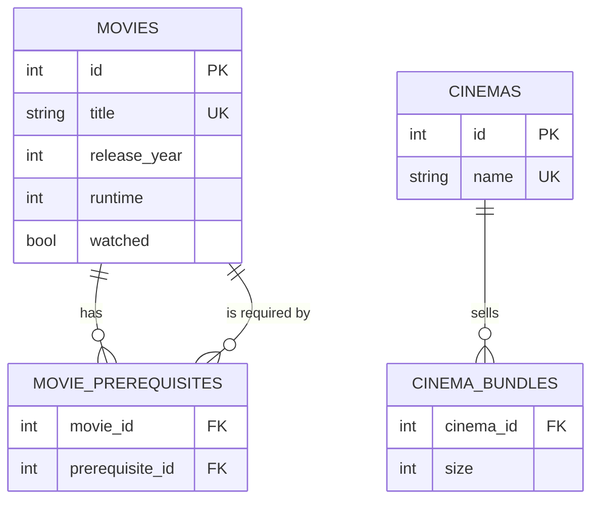

# Doomsday Ready

A full-stack app to plan an MCU rewatch before Avengers: Doomsday and book
an opening-night watch party.

**Stack:** PHP 8 (no framework) + MySQL (XAMPP) + React (Vite)


## ---------- How to run-------------

### Requirements
XAMPP (PHP 8 with `pdo_mysql`, MySQL) and Node.js LTS.

### 1. Database
1. Start **MySQL** in the XAMPP Control Panel.
2. Create a database named `doomsday_ready`.
3. Import `backend/schema.sql`, then `backend/seed.sql` (phpMyAdmin → SQL tab, or the mysql command line).

The connection settings (host `127.0.0.1`, user `root`, empty password) are in
`backend/src/db.php`. Change them there if your MySQL differs.

### 2. Backend
```bash
cd backend
php -S 127.0.0.1:8000 -t public
```

### 3. Frontend (second terminal)
```bash
cd frontend
npm install
npm run dev
```
Open http://localhost:5173. Vite proxies `/api` to the PHP server on port 8000.

## API
| Method | Path | Purpose |
|---|---|---|
| POST | /api/movies | Create a movie |
| GET | /api/movies | List movies |
| PATCH | /api/movies/:id | Update a movie (watched, prerequisites, ...) |
| GET | /api/movies/:id/rewatch-order | Rewatch order |
| POST | /api/cinemas | Create a cinema |
| GET | /api/cinemas | List cinemas |
| GET | /api/cinemas/:id/booking?groupSize=6 | Booking quote |

Errors return JSON `{ "error": CODE, "message": ... }`:
`400 VALIDATION_ERROR`, `404 NOT_FOUND`, `409 DUPLICATE_TITLE`,
`409 DUPLICATE_NAME`, `409 CIRCULAR_DEPENDENCY`.

### --------------------------------END SETUP--------------------------------------- ###


## Algorithms (without using libraries)
**Circular dependency check:** To set movie A as a prerequisite of movie B,  I run an iterative DFS(Depth Fisrt Search) that starts from movie A and digs through the prerequisites of A. The function receives A, B and the prerequisite lists of all movies (the graph) . I use a stack and a visited array. I pop a movie from the stack. And if it is B, a circular dependency would be created , so it got rejected. If it was already visited, I skip it and pop the next one. If not, I mark it as visited and push all its prerequisites onto the stack to dig deeper. If the stack becomes empty and B was never found, it is safe to add A as a prerequisite of B. 

**Rewatch order:** To get the movies to watch before a target movie,I run an iterative DFS (Depth Fisrt Search) that starts from the target. The function receives the target movie and the prerequisite lists of all movies (the graph).I use a stack,a visited array,and an orderlist. Each stack entry holds a movie id and a flag which starts as false.I pop an entry If its flag is true, all of its prerequisites are already finished, so I add the movie to order (unless it is the target itself). If the flag is false and the movie was already visited,I skip it. If it was not visited, I mark it as visited and push the movie back with the flag set to true, then push all of its prerequisites with the flag false, to dig deeper. Because the flagged entry sits below its prerequisites on the stack, it is popped only after they are all done, so every movie appears after its prerequisites. The visited array makes sure a movie reachable by two paths appears once. When the stack is empty order is the rewatch order .For the response,I count how many movies in order are watched and add up the runtime of the unwatched ones only.

**Booking quote:** To find the fewest bundles that make exactly the group size, I use dynamic programming (unbounded coin change). The function receives the cinema’s bundle sizes and the group size. I create a dp array where dp[x] is the fewest bundles needed for exactly x seats. dp[0] is 0 and every other cell starts as infinity, meaning unreachable. I also create a choice array where choice stores the bundle size used last to reach x. For each bundle size, I loop x from that size up to the group size. If x-size is reachable and dp[x-size]+1  is smaller than dp[x], I update dp[x] and set choice[x] to that size. The +1 counts the bundle I am adding. Because x goes upward, a size can be used again and again, so the supply is unlimited. If dp[groupsize] is still infinity, no exact combination exists and the API returns possible:false . Otherwise I rebuild the answer: starting at the group size, I read choice[x], count that size, subtract it from x, and repeat until x is 0. Iuse DP because a greedy approach fails here: for sizes 6, 9, 20 and 44 seats it takes 20 + 20 and gets stuck at 4, while DP finds 20 + 9 + 9 + 6 in 4 bundles.

## Assumptions
- A prerequisite id that does not exist returns 400 `PREREQUISITE_NOT_FOUND`.
- Title and cinema name uniqueness follows MySQL's default case-insensitive collation.
- Duplicate prerequisites and duplicate bundle sizes are merged.
- `releaseYear` must be between 1888 and 2100.
- An impossible booking returns 200 with `possible: false`.
- Creating a movie cannot cause a loop, since nothing depends on a new movie.
- Independent movies in a rewatch order may appear in any order.
- Seed runtimes are made up (sample data only).

## How I used AI

 I used Claude as a AI assistant for this project.

* It provided reference code for the PHP API, the React views and the CSS.
* It helped with PHP and JavaScript syntax, setup (XAMPP, MySQL, Vite, Git)
* It corrected my grammatical mistakes in the README and helped me organize it in a clear order.

## Project Data model
